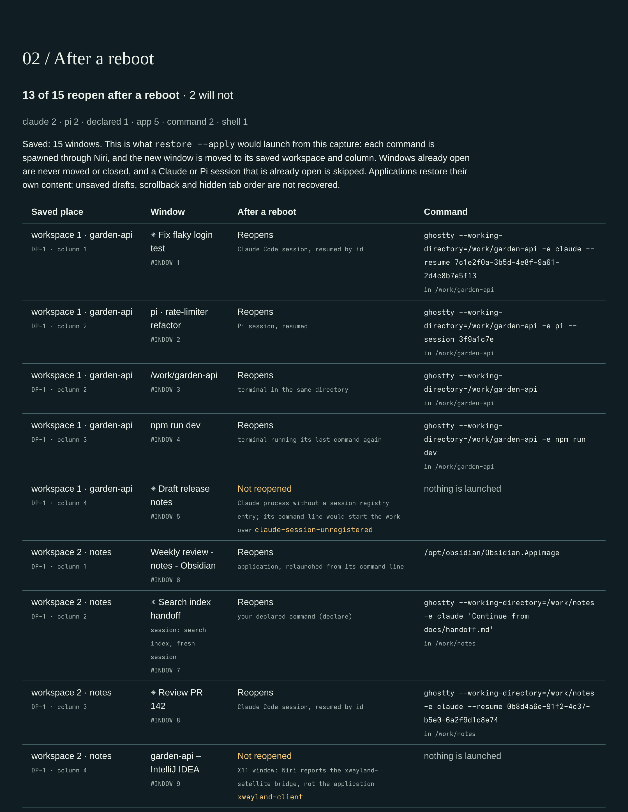

# niri-desktop-continuity

[](https://github.com/tryingET/niri-desktop-continuity/actions/workflows/ci.yml)
[](https://pypi.org/project/niri-desktop-continuity/)
[](https://github.com/tryingET/niri-desktop-continuity/blob/main/LICENSE)

**Reboot, log in, and your [niri](https://github.com/YaLTeR/niri) desktop comes back.** Windows
reopen on their workspaces, in their columns, at their widths. Coding-agent sessions in
[Ghostty](https://ghostty.org) resume by id. Windows it knows it cannot reopen safely, such as X11
apps and agent tabs without a known session, stay closed and are reported.

It is a single command-line tool built on Python's standard library. Once you opt in, it saves your
desktop every 15 minutes and reopens it at login. It runs no daemon and makes no network requests.
Alpha, for niri on Linux only.


<sub>The page that opens when the reopen is over, for a fabricated login run on the demo desktop:
Thunderbird had started itself, Brave reopened two of its three windows, and the two windows that
are never replayed stayed closed.</sub>

## What comes back

| Window | How it reopens |
|---|---|
| An application | Launched once per saved instance, from your own route, its desktop entry or its saved command line. New windows with its app ID fill the saved places. |
| Claude Code in Ghostty | `claude --resume <id>`, in the session's directory |
| Pi in Ghostty | Pi's own resume command for that session (needs a Pi extension, see [Agent sessions](#agent-sessions)) |
| nodecode in Ghostty | The resume command nodecode recorded for its session (nodecode 0.1.5 and later); without a record, like any other command |
| Codex, or another agent whose `SessionStart` hook passes its session id | The session it announced through `hook` |
| A command in a Ghostty tab | The same command, started again (`btop`, `just dev`) |
| A shell in a Ghostty tab | A shell in the same directory |
| An X11 window, or an agent tab in Ghostty with no known session | Not reopened; the preview and the plan say why |

Applications restore their own content. Tabs, documents and drafts are theirs to bring back.

## Requirements

- Linux with niri, and a systemd user session for the automatic save and reopen.
- Python 3.11 or newer. There are no third-party runtime dependencies.
- `xdg-open` (xdg-utils), to open the result page. Without it the page is still written.
- Ghostty, for terminal tabs and the sessions in them. Other terminals reopen as ordinary
  applications; see [Limits](#limits).

## Install

```sh
pipx install niri-desktop-continuity
# or: uv tool install niri-desktop-continuity
```

Releases since 0.1.2 are also on
[GitHub](https://github.com/tryingET/niri-desktop-continuity/releases), with `SHA256SUMS`. What changed is in the
[changelog](https://github.com/tryingET/niri-desktop-continuity/blob/main/CHANGELOG.md).

## Quick start

**1. Save once and look at what would come back.**

```sh
niri-desktop-continuity capture
niri-desktop-continuity preview    # prints the path of an offline HTML page; open it in a browser
```

The page's **After a reboot** section lists every saved window with its saved reopen recipe (kind,
command and directory) or the reason it will not reopen. Your routes and desktop entries can change
the command that actually runs; `restore` without `--apply` shows the plan for the current desktop.



**2. Turn on the automatic save and reopen.**

```sh
niri-desktop-continuity autostart --enable --keep-days 3
```

This writes three systemd user units and starts the timer. The timer captures every 15 minutes and
keeps the captures of the 3 most recent days that have any, plus every capture a receipt or pointer
still names. The restore service reopens at login. `autostart` alone shows whether the units are
installed and enabled; `autostart --disable` removes them and keeps your captures.

**3. Reboot.** Before a planned reboot, save the last few minutes too:

```sh
systemctl --user start niri-desktop-continuity-capture.service
```

At login the restore service waits for niri, and for you to unlock if the session is locked, then
reopens your latest capture. Keep your hands off the keyboard and mouse until the run is over: niri
has no atomic focus-and-move, so input during the run can send a column to the wrong place. When it
is over, its result page opens; if none opens, the journal below says why.

## After a reboot: what happened

When the run is over, it opens its result page in your browser with `xdg-open`: that is your sign
that the run has ended. It says how many windows came back, lists every window that did not with the
reason, and shows your saved desktop with each window marked `BACK`, `ALREADY OPEN` (a session that
was open already), `APP ALREADY RUNNING` (not launched again; the app restores its own windows) or
`NOT BACK`. A run that was refused or skipped, for example because the capture came from the niri
that is running now, writes no page; the journal below says why. The image at the top of this
README is such a page.

`restore --apply --no-open` writes the page without opening it. To write it again for the latest run,
or for any run by its receipt digest:

```sh
niri-desktop-continuity preview --kind receipts    # prints the path of the page
```

The journal has the run in full:

```sh
journalctl --user -b -u niri-desktop-continuity-restore
```

A run that got as far as reopening prints its receipt, with the page's path as `report`, and a copy
is kept with your captures. The receipt's `status` is `reopened` when nothing failed and
`reopened-partially` when some windows did not come back. Each window has its own `status`, for
example `placed`, `already-running` or `not-detected`, and a refused window also has a `reason`.

A partial run exits with status 2, so systemd shows the unit as **failed**. One refused window is
enough, such as an agent tab with no announced session; windows of applications that were already
running count as done. Exit status 2 also means a refused or interrupted run, and the journal says
which.

When the latest capture is unusable because it saw no display (a screen that was off) or caught the
desktop changing, the restore can fall back to the last capture that saw a usable display. It then
logs one line with the `fallback_reason` first. A digest you name never falls back.

## Restore by hand

```sh
niri-desktop-continuity restore                    # dry run: the plan for the current desktop as JSON
niri-desktop-continuity restore --apply            # reopen the latest capture now
niri-desktop-continuity history --kind snapshots   # older captures, by digest
niri-desktop-continuity restore <digest> --apply   # reopen an older one
```

The dry run launches and moves nothing. Use `--apply` when windows are gone while you stay logged in,
for example after closing them by mistake. Like the login run, it opens its result page when it is
done. It skips every saved window of an application that already
has a window open, and every agent session already open with the same reopen command. A plain shell
or command tab cannot be recognised as already open, so on a desktop where it still runs it opens a
second time.

## Agent sessions

A recognised agent (`claude`, `codex`, `pi`, `angel` or `angelx`, `aider`, `gemini`, `opencode`, `goose`,
`crush`, `qwen`, `grok`, `cursor-agent`) in a Ghostty tab or in a window of its own comes back only
through a session it announced or one you declared. It is never relaunched from its command line,
which would replay its opening prompt and start the same work over. A terminal of another kind
that was started with an agent on its command line (`kitty -e claude …`) stays closed for the same
reason; see [Limits](#limits).

- **Claude Code:** read from its per-process session registry, `~/.claude/sessions/<pid>.json`.
  That registry is an undocumented part of Claude Code
  ([anthropics/claude-code#100824](https://github.com/anthropics/claude-code/issues/100824)), so
  the [`SessionStart` hook](https://code.claude.com/docs/en/hooks) below is the documented way to
  cover every session.
- **Pi:** needs the `session-presence` extension from
  [`@tryinget/pi-little-helpers`](https://github.com/tryingET/pi-extensions/tree/main/packages/pi-little-helpers),
  which records each Pi process's session. Install it with
  `pi install npm:@tryinget/pi-little-helpers`
  ([Pi packages](https://github.com/earendil-works/pi/blob/main/packages/coding-agent/docs/packages.md));
  as with any Pi package, its extensions run code, so review it first.
- **nodecode 0.1.5 and later:** records its own session
  ([nodecode#52](https://github.com/nodecode-ai/nodecode/pull/52),
  [release 0.1.5](https://github.com/nodecode-ai/nodecode/releases/tag/v0.1.5)). Nothing to set up.
- **Codex, or another agent whose `SessionStart` hook passes its session id as JSON:** add one hook
  command to the agent's settings.

  ```sh
  niri-desktop-continuity hook claude                           # in ~/.claude/settings.json, hooks.SessionStart
  niri-desktop-continuity hook codex                            # in ~/.codex/hooks.json; trust it once with /hooks
  niri-desktop-continuity hook myagent -- myagent --resume {id} # any other agent
  ```

  See [Codex hooks](https://developers.openai.com/codex/hooks). Interactive Codex sessions run in a
  shared background server by default, which cannot be tied to a tab; start Codex with
  [`--no-daemon`](https://developers.openai.com/codex/cli/reference) where a tab should come back.
- **angelX:** gained a `SessionStart` hook in
  [angelX#22](https://github.com/newjordan/angelX/pull/22), merged on 2 November 2026.
  `niri-desktop-continuity hook angelx` is meant for it but has not been tested with it yet. Until
  your angelX announces its session, its tabs are not reopened unless you declare them.

A session this tool cannot resume, such as a Claude Code session missing from Claude's session
registry, can come back as a fresh session. Declare it while it still runs:

```sh
niri-desktop-continuity declare --pid <pid> -- claude "Continue from docs/handoff.md"
```

`<pid>` is the agent's process (`pgrep -a claude`). The declaration holds while that exact process
runs, at most until the next reboot, and `declare --pid <pid> --clear` removes it. Captures from then
on record it; run `capture` to record it now.

## Guarantees

When it saves and reopens your desktop:

- **It never closes a window, and never moves one that was open before the run.** Reopened columns
  go after them. Input during the run can still misdirect a move, which is why you stay idle.
- **It launches each saved application instance at most once.** Only new windows with that
  application's app ID are adopted, never a window of another application.
- **It does not replay an agent it cannot resume.** A recognised agent in a Ghostty tab, in a
  window of its own or on another terminal's command line is not relaunched without an announced
  session or a declaration.
- **It refuses what it cannot identify.** An X11 window, an AppImage it cannot resolve or a window
  whose process it cannot read is reported, not launched.
- **It drops saved sign-in and deep links.** When an application falls back to its saved command
  line, arguments containing `://` are removed.
- **Nothing runs at login unless you opt in** with `autostart --enable`. Saving and reopening install
  nothing else and edit none of your configuration.
- **Capture never runs a program it finds.** It reads each window's process and hashes its
  executable.
- **No network requests, telemetry or daemon.** The preview and the result page are static HTML with
  no scripts or remote assets. The only page opened for you is the result page, once, at the end of
  a reopen.
- **It never reads terminal contents or browser profiles.** Session ids come from Claude Code's
  session registry, Pi's presence files (from the extension above) and nodecode's shell records.
  From a Claude Code transcript
  it extracts only session titles, to tell apart windows of one terminal process.

## Limits

- **Reopening is not restoring memory.** This tool does not recover unsaved drafts, scrollback, shell
  state or the order of hidden tabs.
- **X11 applications are not reopened**, because niri does not reveal which program owns an X11
  window.
- **Applications decide how many windows they reopen.** If a browser restores fewer windows than were
  saved, the rest are reported `not-detected`; it is never launched a second time.
- **Sessions in other tabs of one Ghostty window reopen as separate windows.**
- **Other terminals are not looked inside.** kitty, foot, Alacritty, WezTerm and the rest reopen
  from their own command line: what you started in them is not reopened, and a command they were
  launched with (`kitty -e htop`) runs again. If any word of that command line names a recognised
  agent, the window stays closed and is reported, even when the word was only a title.
- **Workspaces are matched by position, not by monitor.** Windows return to the first, second or
  third workspace and so on, with empty gaps closed up; which monitor they were on is not restored.
  Saved workspace names are set again, even on a workspace that has another name now.
- **Column widths and floating positions come back; tile heights and floating sizes do not.**

## Your data

Captures, receipts and previews are private: `0700` directories and `0600` files under
`$XDG_STATE_HOME/niri-desktop-continuity` (usually `~/.local/state/niri-desktop-continuity`), or
under `--state-root DIR`. Window and session titles are left out unless you run
`capture --include-titles`. Reopen commands still contain command lines and working directories, so
do not publish captures or previews.

## How it works

`capture` reads the desktop from niri's IPC twice, to check that it held still, and reads the `/proc`
entries of your own processes. It saves a content-addressed snapshot with a reopen recipe for every
window. `restore --apply` takes a lock for the running niri instance and launches the saved
applications through niri, one after another. It adopts their new windows, moves them to their saved
workspaces and columns, and writes a receipt. The
[architecture](https://github.com/tryingET/niri-desktop-continuity/blob/main/docs/architecture.md)
explains the modules, and
[usage](https://github.com/tryingET/niri-desktop-continuity/blob/main/docs/usage.md) documents the
commands and their options.

The tool also has experimental planning, layout and reconstruction commands. None of them is needed
to save and reopen a desktop; see
[recovery](https://github.com/tryingET/niri-desktop-continuity/blob/main/docs/recovery.md).

## Status

Alpha. Before 1.0 a minor release may change the CLI output or the saved-state format, and its
changelog entry says how. On the maintainer's desktop, a login restore on 2 November 2026 reopened
71 of 72 windows in 48 seconds: 30 Claude Code, 24 Pi and 6 nodecode sessions, plus applications,
commands and shells. The one left out was an agent tab with no announced session.

## Develop

```sh
uv sync --group dev
just check         # lint, formatting, tests, portable-source and privacy check
just ci            # check, build the wheel and sdist, then smoke-test the installed wheel
just screenshots   # re-render the README images from the fabricated demo desktop
```

Tests never contact a real compositor. The README images are rendered from the fabricated desktop in
`scripts/demo-desktop.py`, and `just check` rejects PNG metadata that could carry private text.
Releases follow
[docs/release.md](https://github.com/tryingET/niri-desktop-continuity/blob/main/docs/release.md);
the preview's visual rules are in
[DESIGN.md](https://github.com/tryingET/niri-desktop-continuity/blob/main/DESIGN.md).

## Credits

- [niri](https://github.com/niri-wm/niri), by [Ivan Molodetskikh (YaLTeR)](https://github.com/YaLTeR)
  and contributors. [Mastodon](https://mastodon.online/@YaLTeR)
- [Ghostty](https://ghostty.org/), by [Mitchell Hashimoto](https://mitchellh.com) and contributors.
  [X](https://x.com/mitchellh) · [Mastodon](https://hachyderm.io/@mitchellh)
- [Claude Code](https://github.com/anthropics/claude-code), by [Anthropic](https://www.anthropic.com).
  [X](https://x.com/AnthropicAI)
- [Pi](https://github.com/earendil-works/pi), created by [Mario Zechner](https://mariozechner.at),
  with Pi contributors. [X](https://x.com/badlogicgames) ·
  [Mastodon](https://mastodon.gamedev.place/@badlogic) ·
  [Bluesky](https://bsky.app/profile/mariozechner.at)
- [nodecode](https://github.com/nodecode-ai/nodecode), by [Nodecode AI](https://nodecode.ai/).
- [Codex](https://github.com/openai/codex), by [OpenAI](https://github.com/openai).
  [X](https://x.com/OpenAIDevs)
- [angelX](https://github.com/newjordan/angelX), by [Jordan Newman (newjordan)](https://github.com/newjordan)
  and contributors. [X](https://x.com/FrostForger)
- Pi session presence comes from
  [pi-little-helpers](https://github.com/tryingET/pi-extensions/tree/main/packages/pi-little-helpers),
  by [tryingET](https://github.com/tryingET).

## License

Apache-2.0. See [LICENSE](https://github.com/tryingET/niri-desktop-continuity/blob/main/LICENSE).
